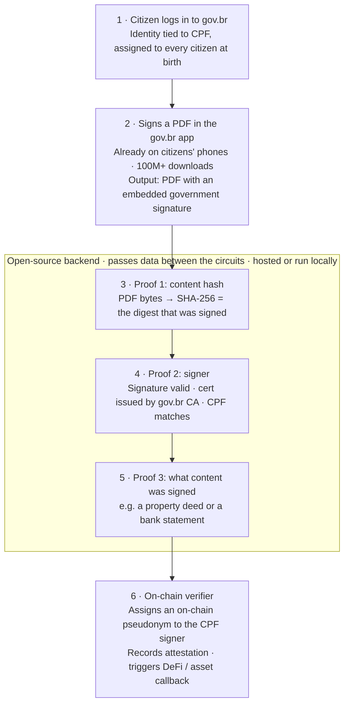

# zk-assinar — minimal flow

**Goal:** an on-chain attestation that *CPF X signed document H* with gov.br, proven in ZK.
No claims about what the PDF says (yet).



### DM version

```
1  citizen logs in to gov.br
   identity tied to CPF, assigned to every citizen at birth
        │
2  signs a PDF in the gov.br app (already on phones, 100M+ downloads)
   output: PDF with an embedded government signature
        │
   ┌─ open-source backend · passes data between circuits · hosted or local ─┐
3  proof 1 · CONTENT HASH   PDF bytes → SHA-256 = the digest that was signed
        │
4  proof 2 · SIGNER         signature valid · cert from gov.br CA · CPF matches
        │
5  proof 3 · CONTENT        what content was signed (e.g. property deed, bank statement)
   └────────────────────────────────────────────────────────────────────────┘
        │
6  on-chain verifier        assigns pseudonym to CPF signer
                            records attestation · DeFi / asset callback
```

### The proofs

| | Private inputs | Checks | Public outputs |
|---|---|---|---|
| **1 · Content hash** | signed PDF / CMS container | signed byte ranges hash to `H`; `H` is the `messageDigest` inside `signedAttrs` | `H`, `hash(signedAttrs)` |
| **2 · Signer** | `signedAttrs`, signature, citizen cert, CPF | RSA signature over `signedAttrs` is valid for the cert key; cert is signed by the gov.br CA; CPF field in cert equals the input CPF | `hash(signedAttrs)` (links to Proof 1), CPF or CPF commitment, CA key id |

The contract checks both proofs, that their `hash(signedAttrs)` match, and that the CA key is trusted,
then records the attestation.

### What changed from the previous design
- **Foundation is now "CPF X signed H"**, not "CPF X signed a PDF that says Y".
- Content is its own proof (proof 3, possibly Jolt substring search), separate from the signer proof.
- Old circuits/contracts/scripts are archived at `../zk-assinar-archive-2026-10-18/`.

### Open decisions
- CPF on chain in the clear, or a salted commitment (`Poseidon(CPF, salt)`)? Old design used the commitment.
- Proof system per step (Noir circuits or Jolt) — the flow doesn't depend on it.
