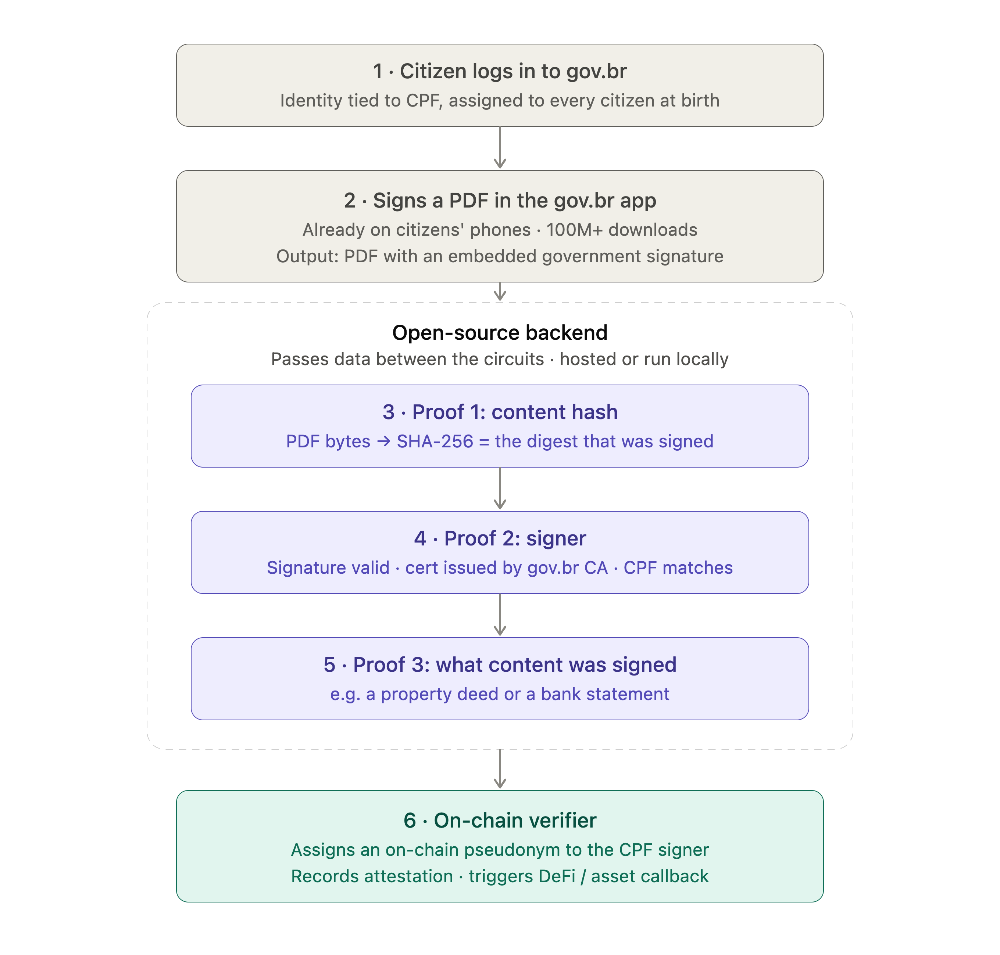

# zk-assinar

Zero-knowledge attestation that a gov.br-signed PDF was signed by a specific CPF holder, recorded on
chain under a salted pseudonym without revealing the CPF or the document.



Mechanisms are explained in [MECHANISMS.md](MECHANISMS.md).

```bash
scripts/test.py        # build, prove the sample PDF, reconstruct + compare, negative cases, forge tests
```

| Path | What |
| --- | --- |
| `circuits/signed_doc` | Proof 1: signedAttrs ↔ `H`, gov.br CA signature on the cert, DER walk, CPF match |
| `circuits/cpf_signer` | Proof 2: RSA-2048 signature over `SHA-256(signedAttrs)` by the cert's key |
| `circuits/common` | CPF check digits, CPF commitment, helpers |
| `backend` | Rust: PDF → circuit inputs → `nargo` + `bb` → proofs (`zk-assinar prove <pdf> --cpf <cpf>`) |
| `backend/ca` | Public gov.br AC Final v1 modulus |
| `contracts` | `AttestationRegistry` + generated verifiers (Foundry) |
| `scripts/build.sh` | Compile circuits, write vks and Solidity verifiers, build backend |

## Dependencies and tooling

- **Noir** `nargo 1.0.0-beta.22`: circuits
- **Barretenberg** `bb 5.0.0-nightly.20260522`: UltraHonk proving, verification keys, Solidity verifiers
- **Noir libraries:** `noir_rsa v0.12.0`, `noir-bignum v0.10.0-2`, `sha256 v0.3.0`
- **Rust** (stable, Cargo): backend; crates `sha2`, `num-bigint`, `getrandom`, `serde_json`
- **Foundry** (`forge`, `forge-std`): contracts and contract tests
- **Python 3** (standard library only): end-to-end test script

`work/` and PDFs are gitignored: they contain personal data.
