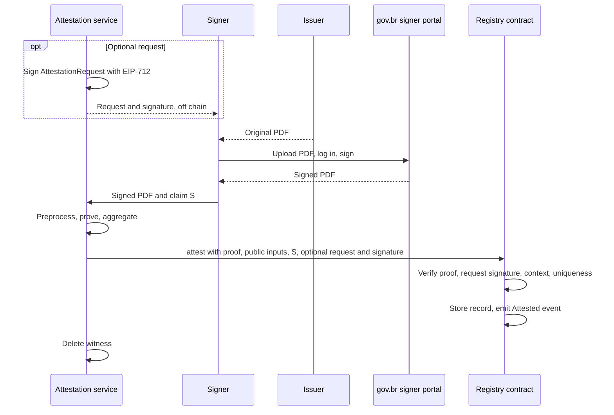
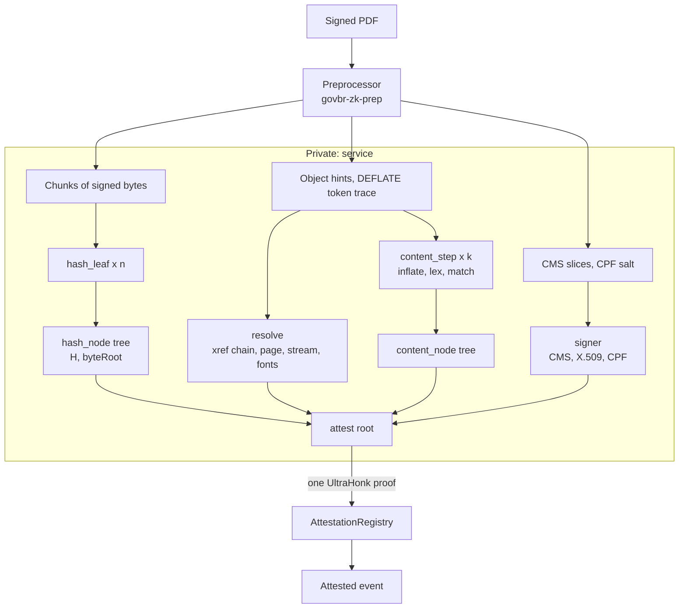
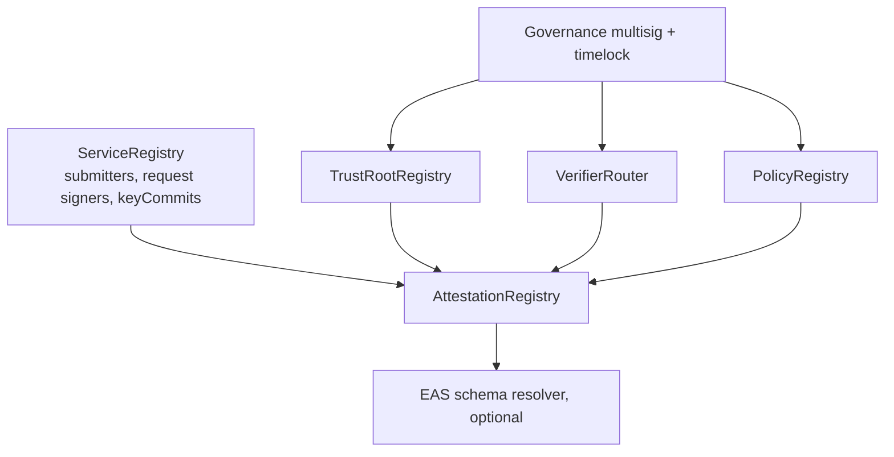

# gov.br Signed-Document Attestation — Technical Specification

**Status:** draft v0.4 · October 2026 · open source (proposed licence: MIT / Apache-2.0)

**Purpose:** a Brazilian citizen signs a PDF that a third party issued (a bank statement, a property deed) with the gov.br signature service (`assinador.iti.br`). The PDF can be any size. A zero-knowledge proof shows that (1) a CPF holder signed the PDF and (2) the signed PDF contains a public string `S`. The attestation service submits the proof to a smart contract, which verifies it and records the attestation. Third parties can check the record without seeing the document or the CPF.

(Zero-knowledge proof: a short cryptographic object that convinces a verifier a statement is true while revealing nothing beyond the statement itself.)

### Changes

| Version | Change |
| --- | --- |
| v0.2 | Removed service-generated templates and the on-chain request. Noir became the primary backend for the whole statement. Jolt became an alternative implementation without an on-chain step. Minimal preprocessor. Salted CPF commitment by default. |
| v0.3 | **Optional attestation request** reinstated as an off-chain EIP-712 ECDSA signature by the service, verified on chain together with the attestation (§4 M9). **Arbitrary document size:** variable-depth byte tree, partial last chunk, content steps aggregated as a tree (§4 M3, M4). The service is the submitter (§4 M7). Added assumed background (§1.1), user-flow table (§3.2), and normative appendices A–H (parameters, PDF subset, lexer, DEFLATE rules, witness bundle, ABI, toolchain, acceptance tests). |
| v0.4 | Removed the relying-party actor; the service alone issues requests. Added the MVP / proof-of-concept scope (§0.1). |

---

## 0. Summary of decisions

1. **One statement, two backends.** The statement and its public inputs are defined once (§5, Appendix F). Noir implements it and is verified on chain. Jolt implements the same checks as one Rust program; its verification is out of scope until Jolt documents an on-chain verifier.
2. **Noir pipeline.** A Noir proof of a general PDF needs SHA-256 over the whole signed file and DEFLATE decompression of one content stream. Both are split into fixed-size step circuits, combined by recursive proof verification into one final UltraHonk proof.
3. **Size-independent circuits.** Circuits have fixed sizes; document size changes only the number of step proofs. A 16 KB file needs 3 hash steps; a 20 MB file needs about 2,600.
4. **Commit once, open many.** The hashing steps also produce `byteRoot`, a Merkle root over the file's bytes. Later circuits read PDF bytes by opening `byteRoot`.
5. **Hint-and-check.** The preprocessor locates objects and `S` and supplies offsets as untrusted inputs. Circuits verify the offsets; they never search.
6. **Optional request.** The service may sign an `AttestationRequest` off chain before the document arrives. It is verified on chain only when the attestation is submitted. No request state exists on chain before that.
7. **CPF privacy.** Publish a salted `signerCommit` by default; publish a keyed `scopeNullifier` only when one-per-person or same-person linkage is needed.

---

## 0.1 MVP / proof-of-concept scope

**Goal.** Attest a document like the sample end to end on an EVM testnet: a gov.br-signed PDF with classic cross-reference tables, `FlateDecode` page content and simple fonts with base encodings, plus a claim string `S`, verified by one on-chain proof. The MVP consists of 7 Noir circuits, the preprocessor, and 2 contracts plus the generated verifier.

| Mechanism | MVP implementation | Deferred |
| --- | --- | --- |
| M1 Preprocessor | Native CLI: `byterange`, `ber`, `cms`, `x509`, classic `xref`, inflate, Appendix C lexer, `locate`, Noir witness output | WASM build, cross-reference streams, object streams, Jolt input |
| M2 `signer` | Full circuit: RSA-2048 leaf, RSA-4096 CA, DER walk, CPF check digits, validity window | — |
| M3 Hash and byte commitment | `hash_leaf`, `hash_node`, `byteRoot` openings; `MAX_DEPTH = 8` (≈ 2 MB signed bytes) | Larger `MAX_DEPTH` |
| M4 Content inclusion | `resolve` (classic xref, inherited resources, one `/Contents` element); `content_step` + `content_node` with the full DEFLATE check; `TEXT_EXACT_V1` + `VIS_V1`; Type 1 / TrueType fonts with base encodings | `/Differences`, `TEXT_WS_V1`, `ToUnicode`, `VIS_V2` |
| M5 Identifiers | `signerCommit` only (`scope`, `scopeNullifier`, `keyCommit` fixed to 0) | Keyed `scopeNullifier`, OPRF |
| M6 Trust root | Tree with the single AC Final v1 key; owner-controlled `TrustRootRegistry` | Multisig and timelock governance |
| M7 Aggregation and registry | `attest` root circuit; `AttestationRegistry` with one verifier and an allow-listed service submitter; claim-hash, context and `(docId, claimHash)` uniqueness checks | `VerifierRouter` versioning, `PolicyRegistry`, `ServiceRegistry` self-registration, EAS resolver |
| M8 Revocation | Manual CRL check by the operator | CRL tool; in-circuit non-membership |
| M9 Request | `attestWithRequest` with EIP-712 verification against one configured request signer, including `maxAttestations` | Signer rotation through `ServiceRegistry` |
| Jolt backend | — | Conformance implementation (milestone M4) |

**Exit criteria.**

1. The sample file is attested on a testnet, with and without a request.
2. These Appendix H vectors are rejected: one flipped signed byte, untrusted CA, claim only in a replaced revision, claim in a comment, invisible text (`3 Tr`), corrupted DEFLATE bit, proof replay, proof submitted with a different request.
3. Measured gate counts, proving times and gas replace the estimates in §7.

**First task.** A stand-alone benchmark of the DEFLATE checks (Huffman decoding and LZ77 copies) on the sample's largest content stream, because no existing Noir implementation was found and the rest of M4 depends on its cost.

---

## 1. Terminology and scope

| Term | Meaning in this spec |
| --- | --- |
| CPF | Cadastro de Pessoas Físicas, the 11-digit Brazilian taxpayer number. Digits 10–11 are mod-11 check digits. |
| gov.br signature | Advanced electronic signature (Lei 14.063/2020) issued by `assinador.iti.br` under the **gov.br PKI** (AC Final do Governo Federal do Brasil v1). |
| e-CPF | An **ICP-Brasil** certificate held by the citizen. Different PKI and CMS layout. Future profile (§12). |
| Issuer | The third party that produced the original PDF. |
| Service | The attestation service: runs the preprocessor and provers, optionally signs requests, submits attestations. |
| `H` | SHA-256 of the bytes covered by `/ByteRange`; the `messageDigest` signed attribute. |
| Signed bytes | `seg1 ‖ seg2` = `bytes[0, b) ‖ bytes[c, c+d)` for `/ByteRange [0 b c d]`. Length `L`. |
| `S` | The public claim string. |
| Witness | All private inputs of a circuit. |
| Public inputs | Values the verifier sees and the proof binds to. |

**What the attestation means.** *A CPF holder, authenticated by gov.br, signed a document whose displayed text contains `S`.* It does not mean the issuer produced the document; a citizen can sign a fabricated statement. Issuer origin needs the issuer-signature profile (§12).

**Trust anchor.** gov.br issues a new leaf certificate for every signature (`notBefore` equals the signing time), which indicates that gov.br generates and holds the leaf key. The signature means gov.br authenticated the account holder and signed `H` on their request.

**Out of scope.** Scanned PDFs (text exists only as pixels). Text drawn inside Form XObjects or annotation appearances (v1; see Appendix B).

### 1.1 Assumed background

The spec is self-contained for architecture, interfaces and acceptance criteria. Byte-level formats defined by external standards are referenced, not restated. An implementer needs working knowledge of, or must read:

| Area | Reference | Needed for |
| --- | --- | --- |
| PDF file structure | ISO 32000-1 §7.3 (objects), §7.5 (file structure, cross-reference, incremental updates), §7.8 (content streams), §9.4 (text objects), §9.6 (simple fonts), §12.8 (signatures), Annex D (character sets) | M1, M4, Appendix B–C |
| zlib / DEFLATE | RFC 1950, RFC 1951 | M4, Appendix D |
| CMS, X.509, ASN.1 | RFC 5652 (§5.3–5.4), RFC 5280 (§4.1), ITU-T X.690 (BER/DER) | M1, M2 |
| RSA signatures | RFC 8017 §8.2 (PKCS #1 v1.5) | M2 |
| SHA-256 | FIPS 180-4 | M3 |
| Noir and Barretenberg | Noir language docs; recursion (`std::verify_proof`, `bb_proof_verification`); `bb` CLI; Solidity verifier generation | All circuits |
| EVM | EIP-712 typed data; ECDSA recovery (`ecrecover`); Foundry | M7, M9 |
| Merkle trees, commitments, nullifiers | Any ZK textbook chapter | M3, M5 |

Items still to be written as separate documents are listed in §13.

---

## 2. Measured structure of the sample file

Parsed and verified byte by byte from the sample (a 14-page bank statement). Personal data are omitted. Items marked † hold for this sample and must be re-checked across more signers and issuers.

| Item | Value |
| --- | --- |
| File size | 355,574 B |
| `/ByteRange` | `[0 312360 345130 10444]`; `c + d` = file length |
| Hole `[b, c)` | 32,770 B: `<`, 32,768 hex digits, `>`. CMS is 2,257 B; the rest is zero padding. |
| Signed bytes | 322,804 B → 5,044 SHA-256 blocks → 41 chunks of 7,936 B |
| Original revision | `[0, 311,874)`, ending in `%%EOF`, preserved verbatim as a prefix |
| Portal incremental update | 485 B in seg1 (new Catalog, widget, start of signature dictionary) + 10,444 B in seg2 (`/ByteRange`, page override adding `/Annots`, appearance stream, stamp image, classic `xref` with `/Prev`). **≈ 10.9 KB fixed overhead per signed file.** |
| Original producer | Ricoh AFP2PDF, PDF 1.4, classic cross-reference tables, no object streams |
| Page content | 14 `FlateDecode` streams: 4–27 KB compressed, 32–205 KB inflated |
| Fonts | Standard 14 Type 1 fonts, not embedded, `WinAnsiEncoding`, no `ToUnicode`, no Type 0 |
| Text encoding | One literal string per line, e.g. `(Ending Balance)Tj` |
| Raw-byte search for a visible string | Fails: `"Ending Balance"` is absent from the raw file because streams are compressed |
| CMS | `SignedData`, BER indefinite length, leaf certificate only†, no unsigned attributes, no timestamp token† |
| `signedAttrs` | 153 B† (3 SHA-256 blocks). `signingTime` content at offset 46 (13 B); `messageDigest` content at offset 121 (32 B) |
| Leaf key / signature | RSA-2048, e = 65537, PKCS #1 v1.5 with SHA-256 |
| Leaf TBS | 1,060 B (17 SHA-256 blocks); serial 9 B† |
| Issuer signature | 512 B → issuing CA key is RSA-4096 |
| Validity | `notBefore` = signing instant; `notAfter` = `notBefore` + 3 years − 1 day |
| Extension order† | SAN, basicConstraints, AKI, certificatePolicies (2.16.76.3.2.1.1), CRL DP, keyUsage (critical), EKU, SKI, AIA |
| SAN | `otherName` 2.16.76.1.3.1 (45 digits: birth date \[0..8\], **CPF \[8..19\]**, NIS \[19..30\], RG \[30..45\]); `otherName` 2.16.76.1.3.6; `otherName` 2.16.76.1.3.5; `rfc822Name` |
| CRL / chain | `http://repo.iti.br/lcr/public/acf/LCRacfGovBr.crl`; `http://repo.iti.br/docs/Cadeia_GovBr-der.p7b` |

---

## 3. System overview

### 3.1 Actors

| Actor | Role | Sees private data |
| --- | --- | --- |
| Signer | Citizen with a gov.br account; obtains the PDF and signs it | Own data |
| Issuer | Produces the original PDF | Own data |
| gov.br portal | Authenticates the signer, signs `H` | Yes (outside this system) |
| Service | Preprocessor, provers, request signer (optional), submitter | **Yes, transiently** |
| Registry contracts | Verify the final proof and the optional request; store the attestation | No |

### 3.2 User flow



| Step | Actor | Action | Output |
| --- | --- | --- | --- |
| 0 (optional) | Service | Builds and signs an `AttestationRequest` (§4 M9); distributes it off chain to the signer | `(request, signature)` |
| 1 | Issuer → Signer | Delivers the original PDF | PDF |
| 2 | Signer → gov.br | Signs the PDF on `assinador.iti.br` | Signed PDF |
| 3 | Signer → Service | Sends the signed PDF and `S` (or the request that fixes `S`) | — |
| 4 | Service | Runs the preprocessor (M1); returns `signerSalt` to the signer | Witness bundle |
| 5 | Service | Proves all step circuits and the root (M2–M7) | Final proof, public inputs |
| 6 | Service | Calls `attest` with the proof, public inputs, `S`, and the optional request and signature | Transaction |
| 7 | Registry | Verifies and records; emits `Attested` | Attestation record |
| 8 | Service | Deletes the PDF and witness | — |
| 9 (optional) | Signer → anyone | Opens `signerCommit` with `(cpf, signerSalt)` | — |

The preprocessor can also run on the signer's device (WebAssembly), in which case step 3 sends the witness bundle instead of the PDF.

### 3.3 Proof structure (Noir)



Child proofs are inputs to the root circuit and never leave the service. Their public inputs (for example `H`) become private witnesses of the root proof.

(Recursive verification: a circuit can contain the verifier of another proof. A large computation is split into steps, each step is proved separately, and one final proof attests that all step proofs were valid.)

### 3.4 Mechanism map

| # | Mechanism | Noir circuit(s) |
| --- | --- | --- |
| M1 | Preprocessing and witness generation | — (Rust) |
| M2 | Signature attestation (CMS + X.509 + CPF) | `signer` |
| M3 | Document hash and byte commitment | `hash_leaf`, `hash_node` |
| M4 | Content inclusion | `resolve`, `content_step`, `content_node` |
| M5 | Identifiers and CPF privacy | `signer` |
| M6 | Trust root | contract |
| M7 | Aggregation and on-chain registry | `attest`, contracts |
| M8 | Revocation | — (v1 off chain), circuit (v2) |
| M9 | Optional attestation request | contract (EIP-712), `attest` (context) |

---

## 4. Mechanisms

### M1 — Preprocessor (`govbr-zk-prep`)

**Requirements.**

- Pure Rust, `#![forbid(unsafe_code)]`, `no_std` + `alloc` core with a thin `std` CLI.
- Builds for native targets and `wasm32-unknown-unknown`.
- No network access, no PDF framework, no ASN.1 framework, no signature-verification library. The circuits are the verifier.
- Direct dependencies: `sha2`, `miniz_oxide`, `serde` + `serde_json`, `getrandom`. Target size under 5,000 lines.
- Streaming over the input: memory use proportional to the largest single stream plus one chunk, not to the file size, so very large files can be processed in a browser.
- Deterministic except for `signerSalt`.

**Modules.**

| Module | Function |
| --- | --- |
| `byterange` | Select the signature (Appendix B), read `/ByteRange`, check `c + d` = file length and that the hole is exactly the `/Contents` hex string. |
| `ber` | Minimal BER/DER reader (tag, length including indefinite form, value slice). |
| `cms` | Slice `signedAttrs`, leaf signature, leaf certificate, TBS, CA signature as raw bytes. Never re-encode. |
| `x509` | Read SPKI modulus, validity, SAN 2.16.76.1.3.1. |
| `xref` | Follow `startxref` → trailer → `/Prev` chain (Appendix B). |
| `object` | Minimal object lexer (ISO 32000-1 §7.2–7.3). |
| `content` | Inflate a stream; content-stream lexer and interpreter with exactly the rules of Appendix C. |
| `locate` | Find `S` under the selected policy; record `(stream, bt_ordinal, run_offset)`; record the DEFLATE token trace and the state at every step boundary. |
| `witness` | Chunking, Merkle paths, step states, `Prover.toml` files, Jolt input file (Appendix E). |

**Outputs.** The witness bundle (Appendix E) and a public-input preview. On failure, one error code from Appendix E.

**Not in the preprocessor.** CRL fetching (M8), the nullifier key `k` and the request-signing key (held by the service in an HSM), proving.

### M2 — Signature attestation (`signer` circuit)

Statement: *a certificate issued by a CA key in the tree with root `trustRoot`, whose SAN contains CPF `cpf`, carries a valid signature over `signedAttrs`, and `signedAttrs` contains `messageDigest = H` and `signingTime = t`.*

1. **Rebuild `signedAttrs`.** Start from the 153-byte constant template (first byte `0x31`, the re-tag of RFC 5652 §5.4). Write `t` (UTCTime `YYMMDDHHMMSSZ`) at offset 46 and `H` at offset 121. `dSA = SHA-256(sa)`. (The signature covers this small attribute block, which in turn contains the PDF hash.)
2. **Leaf signature.** RSA-2048 PKCS #1 v1.5: `σ_leaf^65537 mod n_leaf` equals `00 01 FF…FF 00 ‖ DigestInfo(SHA-256) ‖ dSA`, compared byte by byte; `σ_leaf < n_leaf`.
3. **TBS hash.** `dTBS = SHA-256(tbs)`, variable length ≤ 1,536 B.
4. **DER walk** from TBS offset 0 through `version` (v3), `serialNumber`, `signature` (sha256WithRSAEncryption), `issuer`, `validity`, `subject`, `subjectPublicKeyInfo`, `[3] extensions` (bounded: 16 steps, 12 extensions). Extract `notBefore`, `notAfter`, `n_leaf` (equal to step 2; `e = 65537`), the SAN `otherName` 2.16.76.1.3.1 value (45 ASCII digits); assert `certificatePolicies` contains 2.16.76.3.2.1.1. (DER is a tag-length-value format. Walking it from the start, rather than searching for byte patterns, ensures an extracted field really is that field.)
5. **CA signature.** RSA-4096 PKCS #1 v1.5 over `dTBS`. Merkle membership of `Poseidon2(DS_CA, n_CA limbs)` under `trustRoot` (depth 8).
6. **CPF.** `cpf = san45[8..19]`. `r1 = Σ_{i=1..9} d_i·(11−i) mod 11`, `dv1 = 0 if r1 < 2 else 11 − r1`; `r2 = (Σ_{i=1..9} d_i·(12−i) + 2·dv1) mod 11`, `dv2 = 0 if r2 < 2 else 11 − r2`.
7. **Time.** UTCTime → Unix seconds (years 2000–2049; `Z` suffix required). `notBefore ≤ t ≤ notAfter`. `signedDay = ⌊t / 86400⌋`.
8. **Child public inputs:** `H`, `trustRoot`, `signedDay`, `signerCommit`, `scope`, `scopeNullifier`, `keyCommit`.

### M3 — Document hash and byte commitment (arbitrary size)

Constants (Appendix A):

| Name | Value | Reason |
| --- | --- | --- |
| `CHUNK` | 7,936 B | = 124 SHA-256 blocks = 256 field elements of 31 B |
| `MAX_DEPTH` | 16 | Up to 65,536 chunks ≈ 520 MB; practical limit is the gov.br upload limit (§13) |

Definitions:

- `n = ⌈L / CHUNK⌉` chunks; chunks `0 … n−2` are full; chunk `n−1` holds `L − (n−1)·CHUNK` bytes (1 to 7,936).
- `d = ⌈log₂ n⌉` (`d = 0` when `n = 1`).
- `cc_i = Poseidon2(DS_CHUNK, i, len_i, pack31(chunk_i))`.
- `treeRoot` = Poseidon2 Merkle root of depth `d` over `cc_0 … cc_{n−1}`, absent leaves = 0.
- `byteRoot = Poseidon2(DS_ROOT, L, d, treeRoot)`.

Circuits:

- **`hash_leaf`.** Private: `chunk_i` (padded to 7,936 B), `len_i`, `st_in`. Public: `i`, `st_in`, `st_out`, `cc_i`, `is_last`, `L` (meaningful when `is_last`). Non-last leaves assert `len_i = CHUNK`. The last leaf runs the SHA-256 compressions for its `len_i` bytes plus padding with total length `L` (a variable number of compressions, ≤ 125) and outputs `st_out = H`. (SHA-256 processes data in 64-byte blocks and carries a 32-byte state between them. Splitting at block boundaries and passing the state along gives the same result as one pass.)
- **`hash_node`.** Verifies one or two child proofs with pinned verification keys (`hash_leaf` or `hash_node`). Children cover aligned sibling ranges at the same level; asserts `left.st_out = right.st_in`; outputs the range, level, `left.st_in`, `right.st_out`, `subroot = Poseidon2(DS_NODE, left.subroot, right.subroot)`. A missing right child uses the constant empty-subtree root for that level.
- **Top.** The `attest` circuit takes the top proof (a `hash_leaf` when `n = 1`, otherwise the top `hash_node`), asserts `st_in = IV`, that the range is `[0, n)`, that the last leaf is included, and computes `byteRoot`.

**Openings.** A circuit reads signed-byte indices `[p, p+m)` by taking the covering chunks as private inputs, recomputing each `cc_i`, and verifying a Merkle path of length `d` (a loop of `MAX_DEPTH` iterations, inactive above `d`). File offsets map to signed-byte indices by `abs < b ? abs : abs − holeLen`.

Root public output: `docId = SHA-256(DS_DOC ‖ H)`.

### M4 — Content inclusion

**Claim semantics (policy `TEXT_EXACT_V1`).** In the signed revision, the page reached from the final trailer `/Root` through the page tree has a content stream in which the text-showing operators of one `BT … ET` text object decode to a Unicode sequence containing `S`, and the matched glyphs satisfy `VIS_V1`.

Raw byte matching is not used: content is usually compressed (§2), and text can sit in an unreferenced object, a replaced revision, a comment, image data, or be invisible.

#### `resolve` circuit

Inputs: `byteRoot`, `b`, `holeLen`, chunk openings (≤ 16 chunks), and hints for the `/ByteRange` array, the final `startxref`, each cross-reference section on the `/Prev` chain, and each object on the path `Root → Pages → … → Page → Contents → stream`, plus each `Pages` ancestor that supplies inherited `/Resources`.

Checks:

1. The `/ByteRange` array text equals `[0 b c d]` with `c = b + holeLen`.
2. For every object on the path, the newest cross-reference entry for its number points to the hinted offset, with matching generation, and the bytes there start with `N G obj`. (A PDF can be appended to many times; the cross-reference chain says which version of each object is current, which is the version a viewer displays.)
3. `Root./Pages` reaches the page through `/Kids`; the stream is `Page./Contents` or element `content_index` of it.
4. `/Resources` is taken from the page or the nearest ancestor that has it (inheritance, ISO 32000-1 §7.7.3.4).
5. Stream dictionary: `/Filter` absent or `/FlateDecode` without `/DecodeParms`; `/Length` direct or resolved indirect.
6. Fonts used: per Appendix B.

Outputs: `byteRoot`, `streamStart`, `streamLen`, `filter`, `fontTableCommit`.

#### `content_step` and `content_node` circuits

The decompressed stream is processed in steps. Each step consumes ≤ `IN_STEP` = 8 KiB of compressed data and produces ≤ `OUT_STEP` = 32 KiB of output. The preprocessor computes the state at every step boundary natively, so step proofs are independent and can be proved in parallel; a `content_node` tree links them.

```
StepState {
  k,                     // step index
  bitPos,                // position in the compressed stream (bits)
  blockState,            // stored / fixed / dynamic; bytes left in a stored block; final-block flag
  huffCommit,            // Poseidon2 of current literal/length and distance code lengths
  windowCommit,          // Poseidon2 of the last min(32 KiB, outLen) output bytes
  outLen,
  lexState,              // Appendix C tokenizer state
  textState,             // in BT, current font id, Tr, fill-is-white, optional-content depth, q/Q stack (≤ 16)
  btOrdinal,
  matchState             // characters of S matched so far
}
stateCommit = Poseidon2(DS_STATE, all fields)
```

**`content_step`** (private: previous `StepState`, window bytes, compressed span openings, token trace, `S`; public: `byteRoot`, `streamStart`, `streamLen`, `fontTableCommit`, `claimHash`, `policyId`, `k`, `stateCommit_in`, `stateCommit_out`, `matched`):

1. Open the step's compressed span from `byteRoot`; assert it lies within `[streamStart, streamStart + streamLen)`.
2. **Huffman decoding (hint-and-check).** The token trace gives each token's symbol, code length and extra bits. Block headers are decoded and canonical code tables built and checked per Appendix D. For each token the circuit reads the code bits at `bitPos` and asserts they equal the table code of the claimed symbol. (Huffman codes are prefix-free: a bit sequence decodes in only one way, so a claimed symbol is correct exactly when the bits match.)
3. **LZ77 reconstruction** in a memory of `window ‖ output`: a literal writes one byte; a length/distance pair copies `length` bytes from `distance` bytes back, including overlapping copies (Noir dynamic arrays). (LZ77 replaces a repeated byte string by a pointer to its earlier occurrence.)
4. **Lex and interpret** each output byte per Appendix C.
5. **Decode and match.** String operands of text-showing operators are decoded with the current font's table (Appendix B). When `btOrdinal` equals the hinted ordinal, characters from `run_offset` are compared with `S`; `matchState` carries partial matches across steps.
6. **`VIS_V1`** at each matched character: `Tr` ∉ {3, 7}; fill colour not exact white in DeviceGray, DeviceRGB, DeviceCMYK; optional-content depth 0.
7. `matched = 1` iff `matchState` reaches `|S|` in this step.

For an uncompressed stream, steps 2–3 are skipped and output bytes are the opened bytes.

**`content_node`** verifies one or two child proofs (pinned `content_step` / `content_node` keys); asserts equal `byteRoot`, `streamStart`, `streamLen`, `fontTableCommit`, `claimHash`, `policyId`; asserts `left.stateCommit_out = right.stateCommit_in` and consecutive step ranges; outputs the range and `matched = left.matched OR right.matched`.

The `attest` circuit asserts the top content proof starts at step 0 with the initial state (Appendix A) and `matched = 1`. Steps after the one that completes the match are not needed, so cost depends on where `S` is, not on the stream's total length.

#### Policies

| policyId | Definition | Version |
| --- | --- | --- |
| `TEXT_EXACT_V1` + `VIS_V1` | As above; fonts per Appendix B v1 | v1 |
| `TEXT_EXACT_V1.1` | Adds `/Differences` | v1.1 |
| `TEXT_WS_V1` | Whitespace runs collapse to one space; match may span consecutive text objects | v1.1 |
| `TEXT_CMAP_V2` | Type 0 fonts with `ToUnicode` CMaps | v2 |
| `VIS_V2` | Adds effective font size ≥ 4 pt and glyph origin inside the CropBox | v2 |

Limitations, published with each policy: with embedded fonts the decoded text can differ from the drawn glyphs; `VIS_V1` does not detect occlusion, clipping or non-white backgrounds; anyone holding the signed PDF can create the proof.

### M5 — Identifiers and CPF privacy

**Why a plain hash of the CPF is a problem.** A CPF has 9 free digits, about 10⁹ values. Any public value that is a deterministic function of the CPF and of data the public can obtain can be inverted by computing it for every CPF, in minutes on one GPU. Birth date, NIS and RG are low-entropy and appear in public leaks, and the certificate holds no stable high-entropy value per person (the key pair is new for each signature).

(A hash hides a value only if the value cannot be guessed. A value from a small set must be combined with a secret random value before hashing.)

**When it matters.** Only when the application needs an identifier that is the same for the same person across attestations:

| Need | Example | Deterministic identifier |
| --- | --- | --- |
| Uniqueness | One signature per CPF per campaign | Yes |
| Linkage | Two attestations come from the same person | Yes |
| Endorsement only | "A CPF holder signed a document containing `S`" | No |
| Disclosure to a chosen party | The signer proves an attestation is theirs | No |

**Outputs.**

| Output | Definition | Default |
| --- | --- | --- |
| `signerCommit` | `Poseidon2(DS_SIGNER, cpf, signerSalt)`; `signerSalt` 248 random bits from the preprocessor, kept by the signer | Always |
| `scopeNullifier` | `Poseidon2(DS_NF, k, cpf, scope)` | 0 unless required |
| `keyCommit` | `Poseidon2(DS_KEY, k)` | With `scopeNullifier` |
| `scope` | Public field element | With `scopeNullifier` |

`scopeNullifier` cannot use a fresh salt, and its secret `k` must be outside the signer's control (otherwise the signer could produce many nullifiers). `k` is a 248-bit key held by the service in an HSM and registered on chain as `keyCommit` for `(service, scope)`. Uniqueness therefore holds per service and scope. Compromise of `k` allows enumeration of past nullifiers in that scope; mitigations are per-scope keys and, in v2, a threshold verifiable OPRF.

**Never public:** `H`, CPF, birth date, NIS, RG, name, email, certificate, serial number, keys, signatures, exact signing time.

### M6 — Trust root

- Leaves: `Poseidon2(DS_CA, n_CA limbs)` per accepted issuing CA key. v1 set: AC Final do Governo Federal do Brasil v1 (RSA-4096). Depth 8.
- `TrustRootRegistry` stores roots with `validFromDay` and `validUntilDay`; changes pass through a governance multisig with a 72-hour timelock.
- Before adding a key, governance verifies the chain in `Cadeia_GovBr-der.p7b` to the gov.br root and publishes the chain and leaves.
- A root is accepted for attestations whose `signedDay` falls inside its window.

### M7 — Aggregation and on-chain registry

#### `attest` root circuit

1. Verify four child proofs with pinned verification-key hashes: top hash proof, `resolve`, top content proof, `signer`.
2. Link: `byteRoot` (recomputed from the hash proof) = `resolve.byteRoot` = `content.byteRoot`; `resolve.{streamStart, streamLen, fontTableCommit}` = `content.{…}`; `hash.H = signer.H`; content starts at the initial state and `matched = 1`.
3. `docId = SHA-256(DS_DOC ‖ H)`.
4. `context = Poseidon2(DS_CTX, chainId, registry, submitter, requestId)` — computed in circuit from public inputs so all four are bound to the proof.
5. Expose the public inputs (Appendix F).

The root proof uses the zero-knowledge UltraHonk variant with the Keccak transcript. Child proofs are never published.

#### Contracts



| Contract | State | Write access |
| --- | --- | --- |
| `TrustRootRegistry` | roots and validity windows | Governance (timelock) |
| `VerifierRouter` | `circuitVersion → verifier` | Governance (timelock) |
| `PolicyRegistry` | allowed `policyId` | Governance |
| `ServiceRegistry` | per service: submitter addresses, request-signer address, `keyCommit` per scope | The service itself (permissionless registration) |
| `AttestationRegistry` | records, used uniqueness keys, per-request counters | Registered service submitters |

`attest` (ABI in Appendix F) performs:

1. `msg.sender` is a submitter of a registered service `svc`; `pub.submitter == msg.sender`.
2. `sha256(DS_CLAIM ‖ claim) == pub.claimHash`.
3. `VerifierRouter.verifier(circuitVersion).verify(proof, encode(pub))`.
4. `pub.chainId == block.chainid`, `pub.registry == address(this)`.
5. `TrustRootRegistry.isValid(pub.trustRoot, pub.signedDay)`; `PolicyRegistry.allowed(pub.policyId)`.
6. If `pub.scopeNullifier ≠ 0`: `pub.keyCommit == ServiceRegistry.keyCommit(svc, pub.scope)`; `(svc, scope, scopeNullifier)` unused; mark used.
7. `(docId, claimHash)` unused; mark used.
8. `signedDay ≤ block.timestamp / 86400 + 1`.
9. If `pub.requestId ≠ 0`: request checks of M9. If `pub.requestId == 0`: no request argument.
10. Store the record (including `svc` and `requestId`); emit `Attested`.

**Gas.** One UltraHonk verification costs in the low millions of gas (one published reference: ≈ 2.4 M), plus ≈ 5,000 gas for the request signature. Deploy on an EVM L2; the verifier needs `ecAdd`, `ecMul`, `ecPairing` and `modexp`.

### M8 — Revocation

- v1: the service checks the leaf serial against the CRL before proving (separate tool, not the preprocessor).
- v2: governance publishes `crlRoot`; `signer` proves non-membership; the contract checks freshness.

### M9 — Optional attestation request

**Purpose.** The service commits in advance, off chain, to what it will attest: which claim, under which policy and scope, for which validity window, and optionally how many times. The commitment becomes public and enforceable when an attestation referencing it is submitted. Anyone holding the signed request can later check that attestations match it. No transaction or contract state is created when a request is issued.

**Format (EIP-712).**

```solidity
// Domain: name "GovBrZkAttestation", version "1", chainId, verifyingContract = AttestationRegistry
struct AttestationRequest {
    bytes32 requestId;        // random, < 2^248 (fits one field element), nonzero
    address service;          // the service that will submit
    bytes32 claimHash;        // sha256(DS_CLAIM ‖ S)
    bytes32 policyId;
    uint256 scope;            // 0 = no scope nullifier required
    uint32  notBeforeDay;     // earliest accepted signedDay
    uint32  expiryDay;        // latest accepted signedDay and latest submission day
    uint32  maxAttestations;  // 0 = unlimited
    bytes32 metadataHash;     // hash of an off-chain description (purpose, terms); may be 0
}
```

**Issuance.** The service draws `requestId`, fills the fields, and signs the EIP-712 digest with its request-signer key (ECDSA secp256k1, low-`s`). It distributes `(request, signature)` off chain. A request is independent of any document, so the same request can cover many signers.

**Proving.** The preprocessor receives `requestId` and the service sets it as a public input; the root circuit binds it into `context`. A proof made for one request therefore cannot be reused for another request or for no request.

**On-chain checks** (in `attest`, when `pub.requestId ≠ 0`):

1. `request.requestId == pub.requestId`, `request.service == svc`.
2. `ECDSA.recover(digest(request), signature) == ServiceRegistry.requestSigner(svc)` (current signer; rotating the signer key invalidates outstanding requests).
3. `request.claimHash == pub.claimHash`, `request.policyId == pub.policyId`, `request.scope == pub.scope`; if `request.scope ≠ 0`, `pub.scopeNullifier ≠ 0`.
4. `request.notBeforeDay ≤ pub.signedDay ≤ request.expiryDay` and `block.timestamp / 86400 ≤ request.expiryDay`.
5. If `maxAttestations ≠ 0`: `count[requestId] < maxAttestations`; increment. (The counter is created by the first attestation.)
6. Emit `RequestFulfilled(requestId, attestationId)`.

**Relation to possession mode (§12).** If the service later adds a nonce to the PDF before signing, `requestId` is the nonce, which binds the signing act to the request.

---

## 5. Backend abstraction: Noir primary, Jolt alternative

**Statement specification.** The statement is defined by the checks in §4 M2–M4, the policy table, Appendices A–D, and the public-input vector of Appendix F. A backend is conformant if it accepts exactly the witnesses the reference Rust implementation (`govbr-zk-core`) accepts and outputs the same public-input vector.

|  | Noir (primary) | Jolt (alternative) |
| --- | --- | --- |
| Structure | Step circuits + recursive aggregation (§3.3) | One Rust guest program running `govbr-zk-core` |
| SHA-256 | `sha256` library, chunked | `jolt-inlines-sha2` |
| RSA | `noir_rsa` / `noir-bignum` | Big-integer Rust code |
| DEFLATE | Hint-and-check circuit (new code) | `miniz_oxide` |
| Hints | Private inputs, verified in circuit | `UntrustedAdvice<T>`, verified with `check_advice!` |
| Zero knowledge | ZK UltraHonk variant | `zk` feature (BlindFold), Dory backend only |
| On-chain verification | Barretenberg Solidity verifier | Out of scope until Jolt documents one |

**Jolt guest logic (`govbr_attest`).** Inputs: public `S`, `policyId`, `chainId`, `registry`, `submitter`, `requestId`, `trustRoot`, `scope`, `keyCommit`; private signed bytes, `holeLen`, CMS slices, CA key and Merkle path, `cpf`, `signerSalt`, `k`; untrusted advice: the hints of §4 M4. Steps: (1) `H` over signed bytes and the `/ByteRange` check; (2) M2 checks 1–7; (3) M4 with `miniz_oxide` and the Appendix C interpreter; (4) return the Appendix F vector. All checks use `unwrap_or_spoil_proof` / `check_advice!`. Proofs that leave the service must use the `zk` feature. Very large files are bounded by the guest's configured memory and trace length (§13).

**Conformance testing.** Every corpus file and negative vector (Appendix H) is run through the reference, the Noir pipeline and the Jolt guest; all three must agree on accept/reject and on the public-input vector.

---

## 6. Circuit interfaces (Noir)

| Circuit | Public inputs (children: private in root) | Main private inputs |
| --- | --- | --- |
| `hash_leaf` | `i, st_in, st_out, cc_i, is_last, L` | `chunk[7936], len_i` |
| `hash_node` | `i_lo, i_hi, level, st_in, st_out, subroot, last_included` | 1–2 child proofs + vks |
| `resolve` | `byteRoot, b, holeLen, streamStart, streamLen, filter, fontTableCommit` | ≤ 16 chunks + paths, object hints |
| `content_step` | `byteRoot, streamStart, streamLen, fontTableCommit, claimHash, policyId, k, stateCommit_in, stateCommit_out, matched` | `StepState`, window, ≤ 2 chunks + paths, token trace, `S ≤ 1,024 B` |
| `content_node` | `byteRoot, streamStart, streamLen, fontTableCommit, claimHash, policyId, k_lo, k_hi, stateCommit_in, stateCommit_out, matched` | 1–2 child proofs + vks |
| `signer` | `H, trustRoot, signedDay, signerCommit, scope, scopeNullifier, keyCommit` | `signingTime, leaf_sig, tbs ≤ 1536, n_CA, ca_sig, path, cpf, signerSalt, k` |
| `attest` | Appendix F | four child proofs + vks, link values, `H`, `L`, `d`, `treeRoot` |

---

## 7. Cost model

Per-proof sizes are fixed; counts scale with the document. Gate counts assume roughly 2–3 × 10⁴ UltraHonk gates per SHA-256 compression, to be measured with `bb gates`.

| Circuit | Size (estimate) | Count |
| --- | --- | --- |
| `hash_leaf` | ≈ 2²² gates | `n = ⌈L / 7,936⌉` |
| `hash_node` | ≈ 2²¹ gates (2 recursive verifications) | `n − 1` |
| `resolve` | ≈ 2²¹ | 1 |
| `content_step` | ≈ 2²² | up to the step that completes the match (≤ 32 KiB output each) |
| `content_node` | ≈ 2²¹ | steps − 1 |
| `signer` | ≈ 2²⁰–2²¹ | 1 |
| `attest` | ≈ 2²¹–2²² | 1 |

| Signed file | Hash proofs (leaf + node) | Notes |
| --- | --- | --- |
| 16 KB (one-page PDF + 10.9 KB gov.br overhead) | 3 + 2 | Smallest practical case |
| 322 KB (sample) | 41 + 40 |  |
| 2 MB | 265 + 264 |  |
| 20 MB | 2,643 + 2,642 | Hash tree proving is parallel by level |

On-chain cost is constant (≈ 2.5 M gas) for every size. Jolt alternative: ≈ 31.7 cycles per signed byte for SHA-256 plus inflate and RSA costs (≈ 20–30 M cycles for the sample).

---

## 8. Security analysis

| Threat | Mitigation |
| --- | --- |
| Forged certificate | CA signature in circuit; CA key in `trustRoot`; governed tree with timelock |
| Valid signature, different document | `H` computed from the chunks `byteRoot` commits to; `hash.H = signer.H` |
| Wrong bytes presented to a later circuit | Every read is a `byteRoot` opening; `L` and `d` bound in `byteRoot` |
| String in unreferenced object, old revision, comment, other operator's string, inline image | Resolution through the final cross-reference chain and page tree; lexing from stream start; Appendix B/C rules |
| Forged decompression | Every token checked against the bit stream and a validated canonical code table; copies checked against committed memory; state chained by commitments |
| Hidden text | `VIS_V1` (partial); `VIS_V2` later |
| Glyph/Unicode mismatch with embedded fonts | Stated limitation; policy can be restricted to non-embedded standard 14 fonts |
| Fabricated issuer document | Stated scope; issuer-signature profile (§12) |
| Wrong hints | Untrusted; a wrong hint makes proving fail |
| Mixed-up child proofs | Verification-key hashes pinned in parent circuits |
| Malleable DER extraction | Structural walk from offset 0 |
| Loose RSA padding check | Full encoded-message equality; `σ < n` |
| Replay, cross-chain reuse | `(docId, claimHash)` and `(svc, scope, scopeNullifier)` uniqueness; `chainId`, `registry` |
| Proof moved between requests or submitters | `requestId` and `submitter` bound in `context` |
| Forged or altered request | EIP-712 signature by the registered request signer; low-`s` enforced |
| Request reuse beyond intent | `expiryDay`, `maxAttestations`, `claimHash`, `scope` checks |
| Enumeration of CPF-derived values | Salted `signerCommit`; keyed `scopeNullifier` |
| Under-constrained circuits | Conformance against the reference and Jolt; negative vectors; fuzzing; audit |

---

## 9. Privacy analysis

| Observer | Learns |
| --- | --- |
| Public / chain | `S`, signing day, `policyId`, service, `requestId`, `signerCommit`, `docId`, `scopeNullifier` if used |
| Holder of the signed PDF | Can compute `docId` and recognise the attestation; already knows signer and content |
| Holder of `(cpf, signerSalt)` | Can link one attestation to the CPF |
| Service | Everything, transiently |

Reducing trust in the service: retention policy (delete witnesses, log only public inputs); preprocessor on the signer's device; client-side proving of `signer`; TEE with remote attestation; threshold OPRF for `k`.

**Legal note.** CPF is personal data under the LGPD (Lei 13.709/2018). A salted commitment on a public chain may be treated as pseudonymised personal data. Obtain legal review and record signer consent before mainnet use.

---

## 10. Third-party verification flows

1. **Public check.** Read `Attested` events by `claimHash`: *a CPF holder authenticated by gov.br signed, on day `signedDay`, a document whose displayed text contains `S` under policy `policyId`; submitted by service `svc`.* With a scope, count distinct `scopeNullifier` values.
2. **Request check.** Anyone holding a signed request filters `RequestFulfilled` by `requestId`.
3. **Selective disclosure.** The signer gives `(cpf, signerSalt)` to a chosen party, which recomputes `signerCommit`.
4. **Predicate proof.** A follow-up circuit takes `signerCommit` as input and proves a property of the CPF.
5. **Document holder check.** Compute `docId` from the file and look it up.

---

## 11. Implementation plan

```
govbr-zk/
  crates/
    govbr-zk-core/    reference statement (no_std + alloc): byterange, ber, cms, x509, xref,
                      object, content (inflate, lexer, interpreter, decoding, policies), cpf,
                      commitments, step-state computation
    govbr-zk-prep/    preprocessor CLI + WASM bindings; witness bundle output
    jolt-attest/      Jolt guest (govbr_attest) and host
  circuits/
    lib/              sha256 chunking, Poseidon2, Merkle and byteRoot openings, DER walker,
                      signedAttrs template, CPF, UTCTime, DEFLATE core, lexer tables, encodings
    hash_leaf/ hash_node/ resolve/ content_step/ content_node/ signer/ attest/
  prover/             proof scheduling (leaf → node levels in parallel), bb invocation, CRL tool
  contracts/          TrustRootRegistry, VerifierRouter, PolicyRegistry, ServiceRegistry,
                      AttestationRegistry, EAS resolver (Foundry)
  test-vectors/       consented and synthetic signed PDFs of 16 KB to 20 MB, negative vectors,
                      expected public inputs
```

The MVP (§0.1) covers milestones M0–M3 in reduced scope.

|  | Deliverable | Exit criterion |
| --- | --- | --- |
| M0 | Corpus | ≥ 20 consented gov.br signatures over PDFs from ≥ 10 issuers, sizes 16 KB–20 MB; confirm every † item; measure font, encoding and cross-reference-stream shares |
| M1 | `govbr-zk-core`, `govbr-zk-prep`, `signer`, contracts incl. M9 | Identity-only attestation end to end on a testnet, with and without a request |
| M2 | `hash_leaf`, `hash_node`, openings | Hash tree for 16 KB and 20 MB files; proving time measured |
| M3 | DEFLATE core, `content_step`, `content_node`, `resolve`, `attest` | `TEXT_EXACT_V1` on the corpus; all Appendix H negative vectors rejected |
| M4 | Jolt guest | Conformance with reference and Noir |
| M5 | v1.1 features (Appendix B) | Corpus coverage target met |
| M6 | Audit | External review of circuits, guest and contracts |

The DEFLATE circuit is the main engineering risk; no existing Noir implementation was found. M3 starts with a stand-alone benchmark of the Huffman and LZ77 checks.

---

## 12. Future work

- **Issuer-signature profile:** verify the issuer's own signature on the original revision.
- **Possession mode:** the preprocessor appends an incremental update with `requestId` as a nonce before the signer signs; the circuit checks it.
- e-CPF (ICP-Brasil) profile; v1.1/v2 policies; CRL non-membership in circuit; threshold OPRF; Jolt on-chain verification once documented.

## 13. Open items

**To confirm by measurement or research**

- gov.br root and intermediate certificates; stability across signers of the † items in §2.
- gov.br upload size limit (sets the practical `MAX_DEPTH`).
- Whether the gov.br account level appears anywhere in the CMS or certificate.
- `noir_rsa` 4096-bit parameters; gates per SHA-256 compression; recursive verification cost; Jolt `zk` overhead and memory limits for large files.
- Agreement with the official ITI validator (`validar.iti.gov.br`).

**Specification documents still to be written** (an implementer cannot start the corresponding milestone without them)

| Document | Contents | Blocks |
| --- | --- | --- |
| Lexer state machine | Full transition table for Appendix C, including every escape and EOL case | M3 |
| DEFLATE circuit algorithm | Token-trace format, bit-reading gadget, table-construction constraints, step boundary rules inside a block | M3 |
| Witness bundle JSON Schema | Exact field types for Appendix E | M1 |
| Test-vector catalogue | Files, expected outputs, expected error codes | M0–M3 |
| Governance parameters | Signer set, thresholds, timelocks, upgrade policy | Deployment |
| Operations | HSM setup for `k` and request signer, retention, logging, incident response | Deployment |

---

## Appendix A — Parameters and encodings (normative)

| Item | Definition |
| --- | --- |
| Field | BN254 scalar field |
| Poseidon2 | Noir standard library `Poseidon2::hash(inputs, len)` (Barretenberg parameters, width 4). The Rust reference uses an implementation with identical parameters, checked by shared test vectors. |
| Domain tags | ASCII strings `"GOVBR-ZK/v1/<name>"`, ≤ 31 bytes, encoded as the big-endian integer of their bytes. Names: `doc, claim, chunk, root, node, state, signer, nf, key, ca, ctx`. For SHA-256 inputs the tag is the raw ASCII bytes. |
| `pack31(x)` | Split `x` into 31-byte slices; each slice big-endian → field; last slice right-padded with zeros; chunk inputs always 256 elements |
| 256-bit values as public inputs | `hi` = first 16 bytes, `lo` = last 16 bytes, each big-endian, in that order |
| RSA moduli as Poseidon2 input | 120-bit limbs, little-endian limb order (`noir-bignum` layout) |
| `docId` | `SHA-256("GOVBR-ZK/v1/doc" ‖ H)` |
| `claimHash` | `SHA-256("GOVBR-ZK/v1/claim" ‖ UTF-8(NFC(S)))`; \`1 ≤ |
| Merkle node | `Poseidon2([DS_NODE, left, right], 3)`; empty leaf `0`; empty-subtree roots precomputed per level |
| Initial `StepState` | `k = 0, bitPos = 16` (after the 2-byte zlib header, which is checked by step 0), `outLen = 0`, empty window, lexer normal, not in BT, `Tr = 0`, fill black, OC depth 0, empty q stack, `btOrdinal = 0`, `matchState = 0` |
| Text comparison | Decoded characters and `S` compared as sequences of Unicode scalar values |
| Constants | `CHUNK = 7,936`, `MAX_DEPTH = 16`, `IN_STEP = 8,192`, `OUT_STEP = 32,768`, `MAX_S = 1,024`, trust-tree depth 8, q-stack depth 16 |

## Appendix B — Supported PDF subset

| Feature | v1 | v1.1 | Behaviour if unsupported |
| --- | --- | --- | --- |
| Signature selection | Last signature dictionary in file order whose `/ByteRange` ends at end of file and whose certificate issuer is in the trust set | — | Reject `E_NO_GOVBR_SIG` |
| Earlier signatures (e.g. issuer's) | Ignored | — | — |
| Encryption (`/Encrypt` in trailer) | No | No | Reject `E_ENCRYPTED` |
| Classic cross-reference tables | Yes | — | — |
| Cross-reference streams, hybrid `/XRefStm`, object streams | No | Yes | Reject `E_XREF_STREAM` |
| Page tree depth | ≤ 8 levels | — | Reject |
| Inherited `/Resources` | Yes | — | — |
| `/Contents` array | Yes; the matched text object and its governing `Tf` must lie in one element | — | Reject `E_SPLIT_TEXT` |
| Filters | None, `/FlateDecode` without `/DecodeParms` | — | Reject `E_FILTER` |
| Text in Form XObjects, annotations | No | No (v2) | Not searchable |
| Fonts | `/Type1`, `/TrueType` with `/WinAnsiEncoding`, `/StandardEncoding`, `/MacRomanEncoding`, or no `/Encoding` (font's built-in standard encoding) | `/Differences` | Reject `E_FONT` |
| Type 0, Type 3 fonts | No | No (v2: Type 0 with `ToUnicode`) | Reject `E_FONT` |
| Inline images before the match | No | No | Reject `E_INLINE_IMAGE` (the end-of-data rule for inline images is ambiguous) |
| Optional content | Text inside `BDC /OC … EMC` cannot match | — | — |
| Encoding tables | ISO 32000-1 Annex D tables mapped to Unicode | — | — |

## Appendix C — Content-stream lexer and interpreter rules

- **Whitespace:** `00 09 0A 0C 0D 20`. **Delimiters:** `( ) < > [ ] { } / %`.
- **Comment:** `%` to the next `0A` or `0D`, outside strings.
- **Literal string:** starts with `(`; balanced unescaped parentheses nest; escapes `\n \r \t \b \f \( \) \\`, `\ddd` (1–3 octal digits, value mod 256), backslash followed by EOL (`0D`, `0A`, or `0D 0A`) is removed; any other `\x` yields `x`; an unescaped EOL in any form yields `0A`.
- **Hex string:** `<…>`, whitespace ignored, odd digit count padded with `0`.
- **Numbers, names, arrays, `true`, `false`, `null`:** per ISO 32000-1 §7.3; dictionaries inside content appear only as `BDC` operands.
- **Operands:** a stack cleared after each operator. Only the operands listed below are interpreted.
- **Interpreted operators:** `q`/`Q` save/restore {`Tr`, fill-is-white, current font}; `BT` sets in-text, increments `btOrdinal`; `ET` clears in-text; `Tf name size` sets the current font (size ignored in v1); `Tr n`; `g`, `rg`, `k` set fill-is-white iff operands are `1` / `1 1 1` / `0 0 0 0`; `cs`, `sc`, `scn` set fill-is-white = false unless the colour space is DeviceGray/RGB/CMYK and operands are white; `BDC /OC …` and `BMC` increment OC depth (BMC with a counter only), `EMC` decrements; `Tj`, `'`, `"` show one string; `TJ` shows the strings of its array, ignoring numbers; `BI` → reject per Appendix B.
- **Decoded run:** the concatenation, in order, of the decoded characters of all strings shown inside one `BT … ET`.

## Appendix D — DEFLATE verification rules

- zlib header: `CM = 8`, `CINFO ≤ 7`, `(CMF·256 + FLG) mod 31 = 0`, `FDICT = 0`. Adler-32 trailer not checked.
- Block types 0 (stored: `LEN = ¬NLEN`), 1 (fixed codes of RFC 1951 §3.2.6), 2 (dynamic); type 3 rejected.
- Dynamic header: `HLIT` 257–286, `HDIST` 1–32, `HCLEN` 4–19; code-length alphabet order `16 17 18 0 8 7 9 6 10 5 11 4 12 3 13 2 14 1 15`; repeat code 16 not allowed first; repeats must not cross the end of the length list.
- Code tables: lengths ≤ 15; reject over-subscribed codes; reject incomplete codes except a distance code with exactly one used symbol (zlib behaviour).
- Symbols: literal 0–255, end-of-block 256, length 257–285; reject 286–287 and distance symbols 30–31; distance ≤ 32,768 and ≤ `outLen`.
- Step boundaries may fall inside a block; `blockState`, `huffCommit` and `bitPos` carry the decoder across.

## Appendix E — Witness bundle and error codes

```
bundle.json {
  version, policyId, claim (UTF-8), requestId | null,
  byteRange: [0, b, c, d], L, n, d_tree,
  chunks: [ { i, len, path[] } ... ]          // bytes in chunks/*.bin
  hashStates: [ st_0 ... st_n ]
  resolve: { startxref, xrefSections[], path[], resources[], fonts[], stream: { start, len, filter } }
  content: { btOrdinal, runOffset, steps: [ { k, stateIn, stateOut, inSpan, tokens: "tokens/k.bin" } ... ] }
  signer: { signingTime, leafSig, tbs, caModulus, caSig, trustPath, trustIndex, cpfOffsetHint }
  public: { ...Appendix F preview... }
}
```

`signerSalt` and `k` are not in the bundle: the salt is returned to the signer and injected by the prover at proving time; `k` stays in the service HSM.

Error codes: `E_NO_SIG`, `E_NO_GOVBR_SIG`, `E_BYTERANGE`, `E_TRAILING_DATA`, `E_CMS_PARSE`, `E_CERT_PARSE`, `E_ENCRYPTED`, `E_XREF`, `E_XREF_STREAM`, `E_PAGE_TREE`, `E_FILTER`, `E_FONT`, `E_INLINE_IMAGE`, `E_SPLIT_TEXT`, `E_CLAIM_NOT_FOUND`, `E_CLAIM_TOO_LONG`, `E_TOO_LARGE`.

## Appendix F — Public inputs and contract ABI

Root public-input vector, in order:

| # | Input | Elements |
| --- | --- | --- |
| 1 | `trustRoot` | 1 |
| 2 | `docId` | 2 (`hi`, `lo`) |
| 3 | `claimHash` | 2 |
| 4 | `policyId` | 1 |
| 5 | `signerCommit` | 1 |
| 6 | `scope` | 1 |
| 7 | `scopeNullifier` | 1 |
| 8 | `keyCommit` | 1 |
| 9 | `signedDay` | 1 |
| 10 | `chainId` | 1 |
| 11 | `registry` | 1 (address as integer) |
| 12 | `submitter` | 1 |
| 13 | `requestId` | 1 (0 = none) |

```solidity
struct PublicInputs {
    bytes32 trustRoot; bytes32 docId; bytes32 claimHash; bytes32 policyId; bytes32 signerCommit;
    uint256 scope; bytes32 scopeNullifier; bytes32 keyCommit; uint32 signedDay;
    uint256 chainId; address registry; address submitter; bytes32 requestId;
}

interface IAttestationRegistry {
    function attest(uint16 circuitVersion, bytes calldata proof, PublicInputs calldata pub,
                    bytes calldata claim) external returns (bytes32 attestationId);

    function attestWithRequest(uint16 circuitVersion, bytes calldata proof, PublicInputs calldata pub,
                               bytes calldata claim, AttestationRequest calldata request,
                               bytes calldata requestSignature) external returns (bytes32 attestationId);

    event Attested(bytes32 indexed attestationId, bytes32 indexed claimHash, address indexed service,
                   bytes claim, bytes32 signerCommit, bytes32 scopeNullifier, uint32 signedDay,
                   bytes32 policyId, bytes32 requestId);
    event RequestFulfilled(bytes32 indexed requestId, bytes32 indexed attestationId);
}
```

`attestationId = keccak256(abi.encode(docId, claimHash))`. `attest` requires `pub.requestId == 0`; `attestWithRequest` requires it nonzero.

EIP-712 type string: `AttestationRequest(bytes32 requestId,address service,bytes32 claimHash,bytes32 policyId,uint256 scope,uint32 notBeforeDay,uint32 expiryDay,uint32 maxAttestations,bytes32 metadataHash)`

## Appendix G — Toolchain and build

- Pin exact versions of `nargo`, `bb`, the Rust toolchain, `noir_rsa`, `noir-bignum`, `sha256`, `bb_proof_verification`, and the Jolt commit in the repository; CI fails on drift.
- Circuits, verification keys and Solidity verifiers are reproducible from source; CI publishes every verification-key hash. Parent circuits embed child key hashes as constants, so any child change produces a new `circuitVersion`.
- `VerifierRouter` entries are added only through the timelock, with the verifier's code hash recorded.

## Appendix H — Acceptance tests

Each must be rejected by the reference, the Noir pipeline and the Jolt guest (or accepted, for positive cases), with identical results:

- Positive: sample-like statement; one-page PDF (≈ 16 KB signed); 20 MB PDF; match in the first and in the last content step; match in a `/Contents` array element; inherited resources; uncompressed stream; with and without request; with and without scope.
- Signature: one flipped byte anywhere in the signed bytes; flipped byte in `signedAttrs`; certificate from an untrusted CA; expired root window; `signingTime` outside validity; invalid CPF check digits.
- Structure: unsigned data appended after the signature; claim present only in a replaced earlier revision; claim in an unreferenced object; claim in a comment; claim inside another string's escapes; claim in an image stream.
- Content: invisible text (`3 Tr`), white text, text in optional content, split across text objects (rejected under `TEXT_EXACT_V1`).
- DEFLATE: over-subscribed code; invalid distance; reserved symbol; corrupted bit; wrong token trace.
- Hints: every hint field perturbed by one.
- Contract: replay of the same proof; proof for request A submitted with request B; expired request; wrong signer; `maxAttestations` exceeded; wrong `chainId` or `registry`; unregistered submitter.